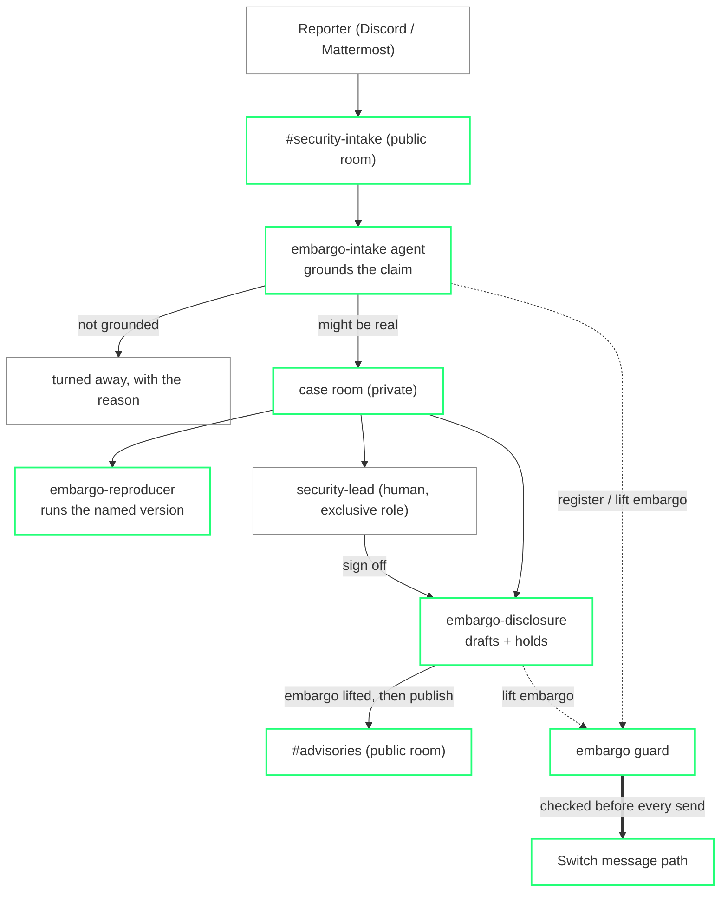

# Embargo

**A maintainer who used to get nine vulnerability reports a month now gets a
hundred and eight. Of roughly five hundred in a year, sixty-three were real.**
Someone still has to open the other four hundred and thirty-seven — and the
real ones have to be handled under embargo, where a leak is its own harm.

Embargo is the desk that handles that flow, inside the team chat the maintainers
already use. Reports arrive in a room. Each claim is checked by grounding it
against the project's own advisory record instead of trusting the write-up. What
does not stand up is turned away with the reason; what might be real opens a
private room where the fix is carried to a human sign-off. And the embargo is
not a promise an agent makes — it is enforced by the chat platform itself, in
the path every message goes through.

Built on [Switch](https://github.com/sandbox-quantum/switch): open-source
infrastructure that puts AI agents into team chat as teammates. Switch is not a
backdrop here — the embargo guarantee *is* a Switch mechanism. Take Switch out
and there is nothing left to enforce it.

---

## The number

On a corpus of 227 real curl reports — every confirmed CVE from curl's own
advisory feed, the curl maintainer's own published list of reports that were
not vulnerabilities, and a negative control of claims that a patched release is
still vulnerable — grounding beats trusting the text:

| | accepts invalid reports | keeps real reports | maintainer review auto-saved |
|---|---|---|---|
| Trust the write-up (baseline) | **85%** | 83% | 0 |
| Embargo (grounded) | **14%** | **100%** | **~26 hours** |

Every figure is read from `bench/results/triage.json`, produced by
`python bench/run.py`. The 14% is the honest limit, not hidden — see
`bench/results/triage.json` and `MOCKS.md`.

## What it does

- **Grounds every report on arrival.** The claimed version and bug class are
  checked against curl's authoritative advisory record. A claim that a patched
  or non-existent release is vulnerable does not stand, and is turned away with
  the reason — before anyone's time is spent on it.
- **Reproduces before it believes.** For a claim that might be real, the
  reproducer runs the named curl version in a sandbox and reports what the
  binary actually does. No verdict without a run.
- **Opens a private case and protects it.** An accepted report gets a private
  room with the reproducer, a human security lead (an exclusive role) and the
  reporter. The report's material is put under embargo.
- **Enforces the embargo in the message path.** The embargo guard answers
  Switch's guardrails contract; Switch calls it before every message and refuses
  any that would carry the case's material into a room the case does not belong
  in. It is code, not a prompt.
- **Discloses only on sign-off.** The disclosure agent drafts the advisory and
  an estimated severity, holds it under embargo, and publishes to the public
  advisories room only after the human security lead signs off — lifting the
  embargo first, then publishing.

## Architecture



Solid green is built and runs today. The reproducer ships as a deterministic
benign probe; a richer coding agent (Claude Code, Codex) can take the same seat
through Switch for a deeper reproduction.

## Run it

**1. Bring up Switch** (its own quickstart — a server, a bundled Mattermost, an
admin). Pin a released version; this was built against `0.31.0`.

**2. Start the guard and seed the desk:**

```sh
python -m venv .venv && . .venv/Scripts/activate      # or bin/activate on *nix
pip install -r guard/requirements.txt -r desk/requirements.txt

EMBARGO_ADMIN_KEY=devkey python -m uvicorn guard.app:app --host 0.0.0.0 --port 19000 &

SWITCH_API=http://127.0.0.1:18000 REG_TOKEN=<switch registration token> \
ADMIN_PW=<switch gateway admin password> BRIDGE_ID=<mattermost bridge id> \
python scripts/seed_desk.py
```

**3. Run the agents** (locally, or with `docker compose -f deploy/desk-compose.yml up`):

```sh
# in three shells, with work/desk.env exported:
python -m desk.agents.intake
python -m desk.agents.reproducer     # set CLAUDE_REPRODUCER=1 to add a Claude Code read
python -m desk.agents.disclosure
```

Switch runs any agent. The reproducer ships deterministic, and with
`CLAUDE_REPRODUCER=1` it also hands the grounded evidence and the sandbox output
to a Claude Code session (via its CLI) for a second, triage-only read posted in
the case room — the "any agent, any model" that Switch is for. A Claude Code or
Codex agent can also join a case room directly through Switch Console.

**4. See it work:** post a report in the intake room and address `@embargo-intake`,
or run the whole path in one go with `python scripts/demo_flow.py`.

**Cross-platform:** reporters can file in Discord while the maintainers' rooms
stay elsewhere — the embargo holds across both because it lives in Switch, not
in either chat app. `scripts/connect_discord.py` registers a Discord bridge and
a Discord intake room (bot token + server id in the env). An agent attends each
platform's room as its own session.

## Proof

- `JUDGES.md` — the five-minute reviewer path.
- `CLAIMS.md` — every claim, its evidence tier, and how to reproduce it.
- `MOCKS.md` — the real-vs-simulated line, drawn plainly.
- `scripts/validate_hook.py` — the embargo refusing a leaking send, HTTP 422.
- `bench/run.py` → `bench/results/triage.json` — the headline numbers.

## Honest limits

- The reproducer runs **benign** capability checks — it confirms a release and
  its options exist; it does not exploit anything. `MOCKS.md` has the details.
- The guard blocks a case's material as written; a deliberate paraphrase to
  evade it is out of scope for this version.
- Switch's global guardrails policy fails open if the guard is unreachable, so
  the guard runs beside the server. Within a reachable guard, decisions
  fail closed.
- Severity is a labelled estimate for a human to confirm, not a computed CVSS
  vector.

## Corpus

Built from public sources, no hand-labelling: curl's OSV advisory feed
(`curl.se/docs/vuln.json`) for confirmed CVEs, and the curl maintainer's own
published list for reports that were submitted as vulnerabilities and were not.
Rebuild with `python bench/build_corpus.py`.
